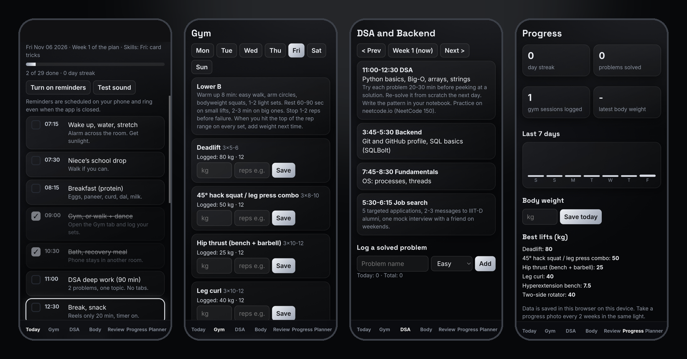
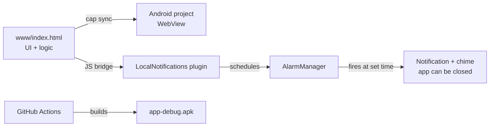

# Level Up

[](https://github.com/Aryan22109/level-up/actions/workflows/android.yml)


A dark, offline-first Android app that runs my whole day: a timetable with reminders that ring even when the app is closed, a gym logger, a DSA tracker, body-care checklists, steps, one-swipe calls, and a weekly review.

I built it for myself while preparing for software roles, and I use it every day.



## Features
- **Daily timetable.** A checklist for every block of the day, with the current block highlighted, a progress bar, and a streak that treats Sunday as a rest day.
- **Native reminders with a custom chime.** Scheduled on the phone with Android alarms, so they fire with the app closed.
- **Gym log.** An upper/lower split built around the equipment in my gym. Logs weight and reps per exercise, shows last session's numbers, and tracks best lifts.
- **DSA and backend tracker.** A six-week roadmap, plus a log of solved problems by difficulty.
- **Body care.** Daily skincare and posture checklists, weekly extras, and appointments to book.
- **Progress and weekly review.** Streaks, a 7-day completion chart, a body-weight graph, auto-generated coach notes, and a written reflection (win, improve, focus).
- **Steps and quick calls.** Log daily steps, and call family or friends with one swipe.
- **Custom planner.** Rebuild the timetable from your own goals (the AI draft is part of the planned backend, see the roadmap).

## Tech stack
| Layer | Choice |
|---|---|
| UI and logic | Vanilla HTML, CSS and JavaScript (single page, no framework) |
| Storage | `localStorage` (data stays on the phone) |
| Native shell | [Capacitor](https://capacitorjs.com) 6 (Android WebView + JS bridge) |
| Reminders | `@capacitor/local-notifications` (Android `AlarmManager`) |
| App icon and splash | `@capacitor/assets`, generated from source images in `assets/` |
| CI/CD | GitHub Actions builds the APK and attaches it to releases |

## How it works

The web app runs inside an Android WebView. Capacitor's bridge lets the JavaScript call native code, so the app can schedule real Android alarms instead of relying on a page that must stay open. More detail is in [docs/ARCHITECTURE.md](docs/ARCHITECTURE.md).

## Install the app
1. Open the [Releases](https://github.com/Aryan22109/level-up/releases) page and download `level-up.apk`.
2. Open it on your Android phone and allow "install unknown apps" when asked.
3. Open the app, tap **Turn on reminders**, and allow notifications.
4. For reliable reminders, set the app's battery usage to **Unrestricted** in Android settings.

## Build it yourself
**In the cloud (easiest).** Push to `main` and open the **Actions** tab. The run uploads `level-up.apk` as an artifact. Push a tag like `v1.0.0` to publish it as a release.

**Locally.** Needs Node 20, Java 17 and Android Studio.
```bash
npm install
npx cap add android
npx capacitor-assets generate --android
mkdir -p android/app/src/main/res/raw android/app/src/main/res/drawable
cp assets/chime.wav android/app/src/main/res/raw/chime.wav
cp assets/ic_stat_levelup.png android/app/src/main/res/drawable/
python3 scripts/add_permissions.py
npx cap sync android
npx cap open android
```
To try the UI without Android, open `www/index.html` in a browser.

## Project structure
```
www/index.html             the whole app (UI, logic, storage)
assets/                    icon, splash source images, notification chime
scripts/add_permissions.py adds the Android permissions reminders need
capacitor.config.json      app id, name, notification settings
.github/workflows/         CI that builds the APK
docs/                      screenshots and architecture notes
```

## Roadmap
- [ ] FastAPI backend with JWT login so data syncs across devices
- [ ] AI planner that drafts a timetable from your goals (needs the backend)
- [ ] Signed release builds so updates install over the old version
- [ ] Charts for lifts over time and steps
- [ ] Split `index.html` into modules and add tests

## What I learned
- How a web app becomes a native app with Capacitor, and where the JavaScript-to-native boundary sits.
- Why Android reminders need exact-alarm permission, notification channels, and battery exemptions.
- Setting up a CI pipeline that builds a mobile app from scratch on every push.
- Designing a mobile-first dark UI with CSS variables and no framework.

## License
MIT
